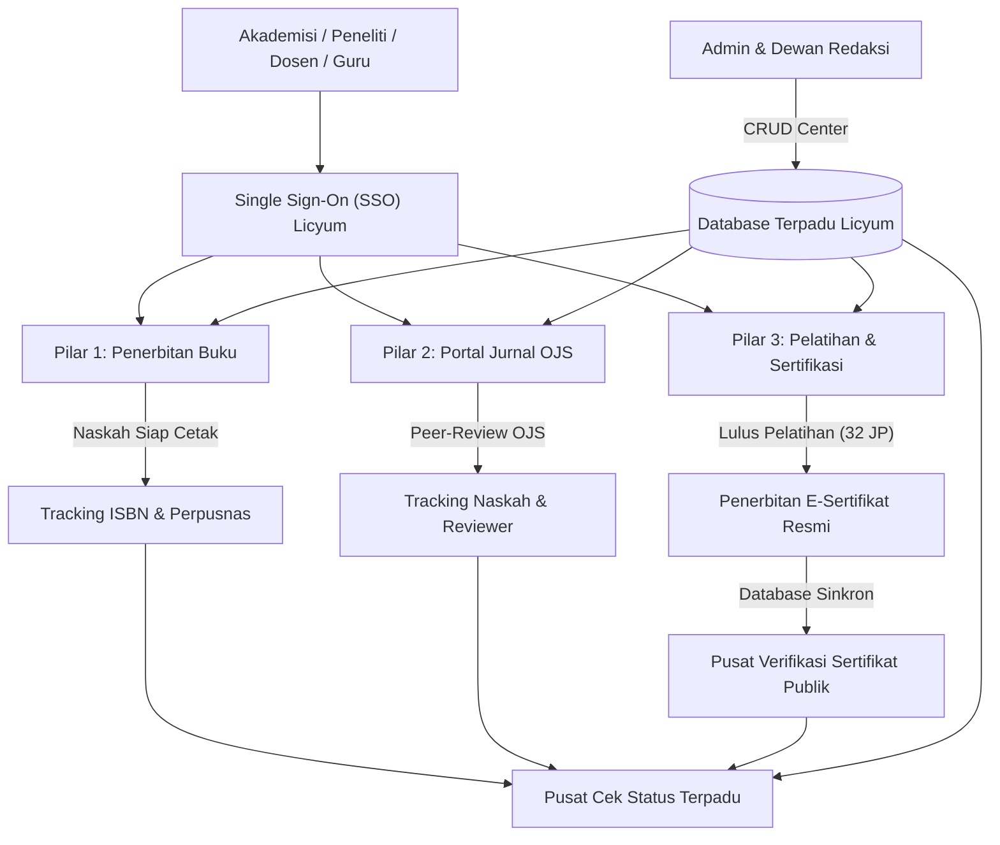

# Licyum — Ekosistem Terpadu Publikasi Buku, Jurnal Ilmiah & Pelatihan Pendidikan

Platform web terintegrasi modern, bersih, profesional, dan akademis yang menyatukan 3 pilar layanan utama dalam satu atap:
1. **Pilar 1: Penerbitan & Toko Buku** (Inspirasi: Penerbit KBM) — Pengurusan ISBN Perpusnas, Hak Cipta HAKI Kemenkumham, konversi skripsi/tesis, dan katalog buku akademik.
2. **Pilar 2: Portal Jurnal Ilmiah** (Inspirasi: E-Journal OJS) — Pengelolaan berkala ilmiah terindeks SINTA 2-4 & DOAJ, penerbitan paper ber-DOI Crossref aktif, download full-text PDF gratis, panduan penulis, dan cek Turnitin.
3. **Pilar 3: Lembaga Pelatihan & Konsultan Pendidikan** (Inspirasi: Kuanta.id) — Workshop penulisan naskah Scopus, in-house training sekolah/kampus 32-40 JP, sertifikasi BNSP, serta fitur verifikasi dan unduh e-sertifikat resmi online.

---

## 🌐 1. Arsitektur Ekosistem Terpadu (The Ecosystem)

Platform Licyum bukan sekadar portal terpisah, melainkan sebuah **ekosistem terintegrasi** yang menghubungkan seluruh siklus hidup karya ilmiah dan kompetensi akademisi:



### Alur Ekosistem Nyata:
1. **Workflow Konversi Tugas Akhir**: Skripsi, tesis, atau disertasi mahasiswa/dosen diajukan -> Direview oleh editor doktoral -> Terbit ber-ISBN di Toko Buku Licyum ATAU disadur menjadi artikel ilmiah di e-journal SINTA 2-4.
2. **Workflow Pelatihan ke Sertifikasi**: Dosen mendaftar workshop (e.g. Masterclass Scopus 32 JP) -> Mengikuti pelatihan -> Admin/Instruktur menerbitkan E-Sertifikat di Admin CRUD -> E-Sertifikat otomatis masuk ke database publik dan langsung dapat diverifikasi oleh instansi/kampus penguji.
3. **Workflow Transparansi Status (Tracking)**: Setiap pengajuan ISBN atau submisi naskah OJS memiliki kode pelacakan unik (`ISBN-xxxx` atau `JRN-xxxx`). Tim redaksi memperbarui status di Admin CRUD, dan penulis dapat memantau persentase progres dan catatan revisi secara langsung.

---

## 🗄️ 2. Database Layer (Database Architecture)

Arsitektur database dirancang ANSI SQL compliant dan kompatibel dengan PostgreSQL, MySQL, dan SQLite:

- **File Skema SQL**: [`database/schema.sql`](file:///E:/licyum/database/schema.sql)
- **File Seed Awal**: [`database/seed.sql`](file:///E:/licyum/database/seed.sql)
- **Database Engine & ORM Layer**: [`src/lib/database.ts`](file:///E:/licyum/src/lib/database.ts)

### Tabel-Tabel Utama:
| Nama Tabel | Deskripsi & Fungsi | Kunci Utama / Index Penting |
| :--- | :--- | :--- |
| `users` | Akun pengguna SSO (Super Admin, Editor, Reviewer, Peserta) | `id`, `email (UNIQUE)` |
| `book_categories` | Klasifikasi bidang ilmu buku (Pendidikan, AI, Hukum, dll) | `id`, `slug` |
| `books` | Data katalog buku ber-ISBN, harga, stok, sinopsis, royalti | `id`, `isbn (UNIQUE)` |
| `publishing_submissions` | Antrean naskah buku, progres tracking ISBN di Perpusnas | `id`, `tracking_code (UNIQUE)` |
| `book_orders` | Transaksi pemesanan buku dan alamat kirim pelanggan | `id`, `order_number (UNIQUE)` |
| `journals` | Daftar berkala ilmiah yang dikelola (SINTA 2-4, ISSN, OJS URL) | `id` (e.g. `ljet`, `jist`, `lser`) |
| `articles` | Repositori paper ilmiah, abstrak, pengarang, metadata DOI | `id`, `doi (UNIQUE)` |
| `training_programs` | Jadwal workshop, kuota, instruktur, harga Early Bird | `id` |
| `training_registrations` | Pendaftaran peserta diklat, nomor induk, status bayar | `id`, `registration_number` |
| `certificates` | Database e-sertifikat resmi 32-40 JP terverifikasi | `id`, `certificate_number (UNIQUE)` |

---

## ⚡ 3. Operasi CRUD & Pusat Kontrol Admin (CRUD Operations)

Platform dilengkapi sistem CRUD menyeluruh di dua tingkatan:

### A. RESTful API Endpoints (Next.js App Router)
- **Buku**:
  - `GET /api/books` — Mengambil semua buku / filter pencarian
  - `POST /api/books` — Menambahkan buku baru ke katalog
  - `GET /api/books/[id]` — Detail satu buku
  - `PUT /api/books/[id]` — Memperbarui data buku (harga, stok, sinopsis)
  - `DELETE /api/books/[id]` — Menghapus buku dari katalog
- **Artikel Jurnal**:
  - `GET /api/articles` — Mengambil daftar paper ilmiah
  - `POST /api/articles` — Mempublikasikan naskah baru ke OJS
  - `PUT /api/articles/[id]` — Memperbarui abstrak, DOI, atau volume
  - `DELETE /api/articles/[id]` — Menghapus paper dari repositori
- **Pelatihan**:
  - `GET /api/trainings` & `POST /api/trainings` — Manajemen jadwal workshop
  - `PUT /api/trainings/[id]` & `DELETE /api/trainings/[id]` — Perbarui kuota / hapus
- **Sertifikat**:
  - `GET /api/certificates` — Daftar seluruh sertifikat terbit
  - `GET /api/certificates/[number]` — Verifikasi keaslian sertifikat
  - `POST /api/certificates` — Penerbitan nomor sertifikat baru
  - `DELETE /api/certificates/[id]` — Pencabutan sertifikat
- **Status Tracking**:
  - `GET /api/tracking` & `GET /api/tracking/[code]` — Cek status progres
  - `POST /api/tracking` & `PUT /api/tracking/[code]` — Update persentase dan catatan tim redaksi

### B. Interactive Admin CRUD Dashboard (Frontend Management Panel)
Tersedia tombol emas **"CRUD Admin"** di bagian atas navbar. Admin dapat:
1. **Tambah / Hapus Buku**: Langsung tampil di katalog 4 kolom dan hasil pencarian Hero.
2. **Publikasikan Artikel OJS**: Menambahkan paper baru yang langsung terdaftar di daftar artikel terbaru.
3. **Terbitkan E-Sertifikat**: Masukkan nomor sertifikat baru (misal: `LCY-2026-TEST-777`) -> Buka menu *Verifikasi Sertifikat* -> Nomor tersebut **langsung valid dan terverifikasi** lengkap dengan tombol unduh berkas!
4. **Update Progres Tracking**: Ubah persentase naskah `ISBN-9281-2024` dari 85% ke 100% -> Klik menu *Cek Status* -> Persentase langsung terupdate real-time.
5. **Reset Database**: Mengembalikan database ke setelan awal pabrik kapan pun dibutuhkan.

---

## 🔐 4. Integrasi Environment Variables (.env)

Platform Licyum menggunakan sistem konfigurasi terpusat berbasis file `.env` yang divalidasi oleh modul [`src/lib/config.ts`](file:///E:/licyum/src/lib/config.ts):

- **File Aktif**: [`.env`](file:///E:/licyum/.env)
- **File Template / Contoh**: [`.env.example`](file:///E:/licyum/.env.example)
- **Modul Konfigurasi**: [`src/lib/config.ts`](file:///E:/licyum/src/lib/config.ts)

### Daftar Variabel Lingkungan Utama:
| Variabel | Lingkup | Nilai Default / Deskripsi |
| :--- | :--- | :--- |
| `NODE_ENV` | Server | `development` / `production` |
| `NEXT_PUBLIC_APP_NAME` | Klien & Server | `"Licyum Indonesia"` |
| `NEXT_PUBLIC_APP_TAGLINE` | Klien & Server | `"Ekosistem Terpadu Penerbitan Buku, Jurnal Ilmiah & Pelatihan"` |
| `NEXT_PUBLIC_APP_URL` | Klien & Server | `http://localhost:3000` |
| `DATABASE_TYPE` | Server | `'sqlite'` (default) / `'postgres'` / `'mysql'` |
| `DATABASE_URL` | Server | Connection string PostgreSQL/MySQL |
| `SQLITE_DB_PATH` | Server | `./database/licyum.db` |
| `JWT_SECRET` | Server | Kunci rahasia token Single Sign-On (SSO) |
| `NEXT_PUBLIC_IKAPI_MEMBER_NUMBER` | Klien & Server | `"612/DKI/2022"` (Nomor resmi keanggotaan IKAPI) |
| `PERPUSNAS_ISBN_API_KEY` | Server | Kunci API resmi integrasi ISBN Perpustakaan Nasional RI |
| `OJS_BASE_URL` | Server | `https://journal.licyum.id` (URL instalasi OJS 3) |
| `CROSSREF_DOI_PREFIX` | Server | `10.58921` (Prefix resmi DOI Crossref Licyum) |
| `TURNITIN_ACCOUNT_ID` | Server | ID Akun Turnitin No-Repository |
| `CERTIFICATE_SIGNER_NAME` | Server | Nama penandatangan sertifikat (Prof. Dr. Agus Raharjo) |
| `CERTIFICATE_SECRET_HMAC` | Server | Kunci kriptografi validasi barcode sertifikat |
| `NEXT_PUBLIC_WHATSAPP_NUMBER` | Klien & Server | `6281234567890` (Hotline otomatis pemesanan buku & diklat) |
| `NEXT_PUBLIC_SUPPORT_EMAIL` | Klien & Server | `redaksi@licyum.id` |

---

## 🚀 Cara Menjalankan & Menguji

### 1. Instant Preview (Langsung di Browser Tanpa Install Apapun)
Cukup klik dua kali atau buka file:
```
E:\licyum\index.html
```
Seluruh ekosistem, database interaktif persistent, dan modul CRUD berjalan 100% mulus di peramban Anda.

### 2. Lingkungan Next.js 14+ (Mode Pengembang)
```bash
# 1. Masuk ke folder proyek
cd E:\licyum

# 2. Salin template environment jika belum ada
cp .env.example .env

# 3. Instal dependensi
npm install

# 4. Jalankan server lokal
npm run dev

# 5. Akses melalui peramban
http://localhost:3000
```
